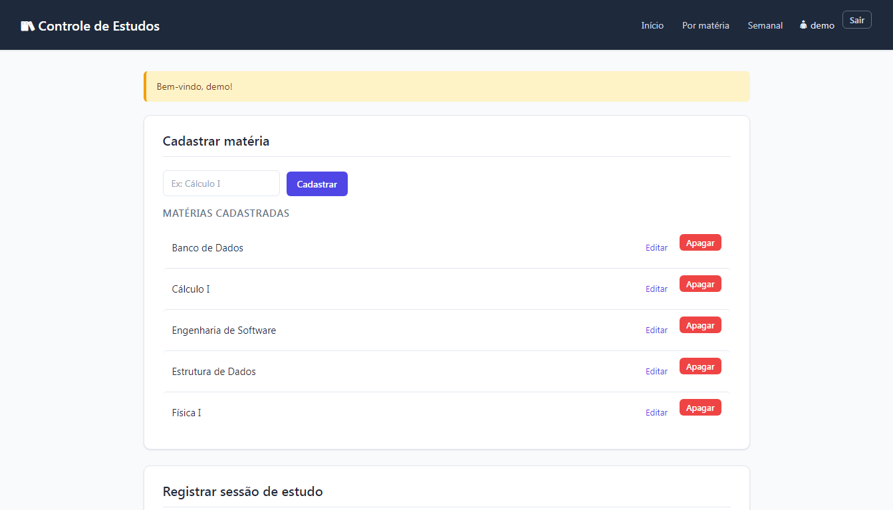
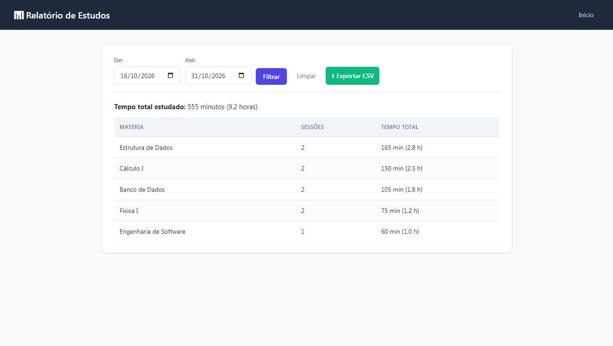
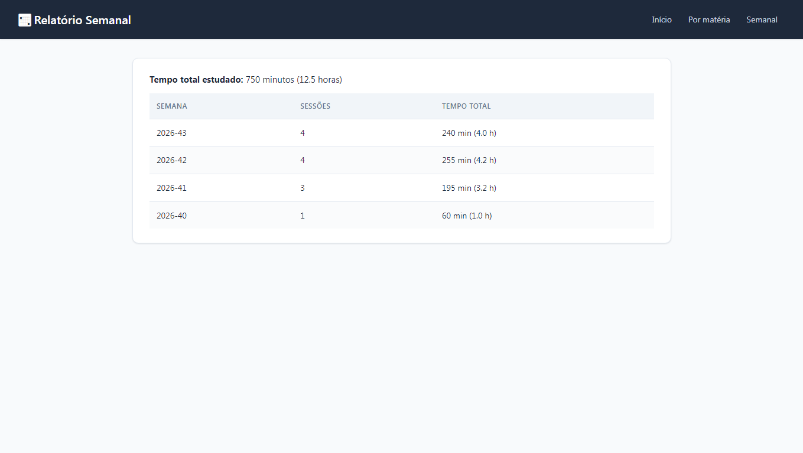
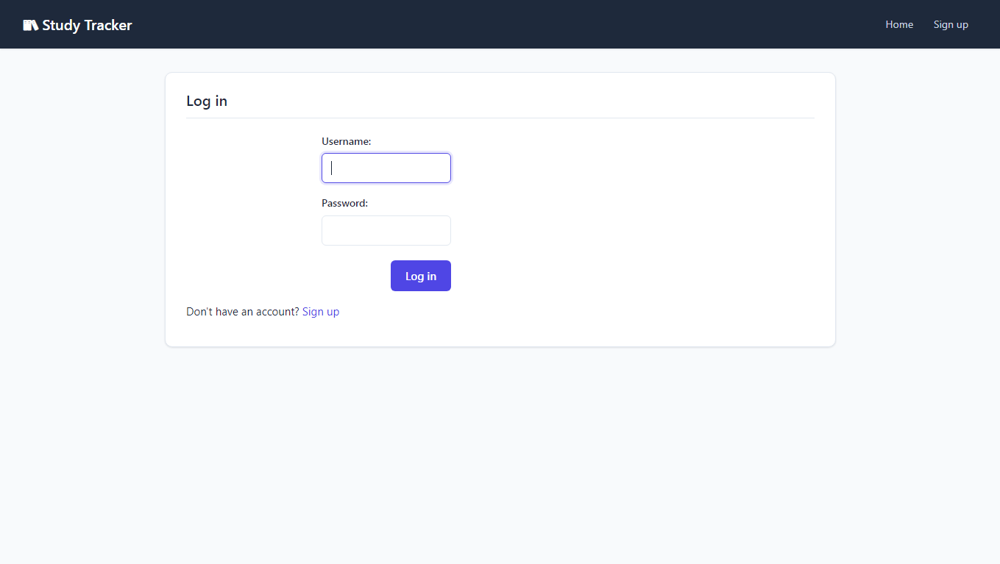

# Study Tracker

[](https://github.com/pedrohfernandes99/controle-estudos/actions/workflows/ci.yml)

🔗 **[Live Demo](https://pedrohfs.pythonanywhere.com)** — try it out (user: `demo`, password: `demo1234`)

A web application to log study sessions per subject, track time spent on each one, and visualize progress over time.

## Screenshots

### Home — subjects and recent sessions



### Per-subject report with date filter



### Weekly breakdown



### Login




## Status

🚧 **Active development** — core features working, authentication in progress.

- ✅ Subject and session management (full CRUD)
- ✅ Per-subject report with date-range filter
- ✅ Weekly breakdown report
- ✅ CSV export (respects the active filter)
- ✅ Automated test suite (33 tests)
- ✅ Continuous integration with GitHub Actions
- 🚧 Authentication: registration, login and logout working; route protection pending

## Features

### Subjects and sessions
- Create, edit and delete subjects
- Log study sessions (subject, duration in minutes, date, notes)
- Edit and delete individual sessions
- Cascade delete: removing a subject also removes its sessions

### Reports
- Total time per subject
- Filter by date range (`start` / `end`)
- Weekly breakdown (year-week grouping)
- CSV export of detailed sessions (semicolon-separated for Excel pt-BR compatibility)

### Authentication (in progress)
- User registration with password confirmation
- Secure password storage using Werkzeug's `generate_password_hash`
- Login / logout with Flask session cookies
- ⚠️ Route protection (`@login_required`) still pending

## Tech Stack

- **Python 3.8** + **Flask 2.0.3**
- **SQLite** (local database, no server required)
- **Jinja2** (HTML templates)
- **Werkzeug** (password hashing)
- **pytest 8.3.5** (33 automated tests)
- **GitHub Actions** (CI on every push)

## Running locally

```bash
python -m venv venv
.\venv\Scripts\Activate.ps1        # Windows PowerShell
pip install -r requirements.txt
python run.py

## About this project

I built Study Tracker to solve a problem I actually have: keeping track of how much time I spend on each subject during the semester. Most study apps are too complex or require a paid subscription, so I decided to build a lightweight, self-hosted alternative.

### What I learned
- **Full-stack fundamentals**: connecting a Flask backend to SQLite, rendering dynamic templates with Jinja2, and handling user sessions.
- **Security basics**: never storing plain-text passwords (using Werkzeug's `generate_password_hash`), protecting routes with a custom `@login_required` decorator, and ensuring data isolation (users can only see their own data).
- **Testing culture**: writing 55 automated tests with `pytest` and setting up a CI pipeline with GitHub Actions to catch bugs before they reach production.
- **Working with constraints**: my development machine is a Windows 7 / 4GB RAM setup. I had to pin specific versions of Flask (2.0.3) and Python (3.8) and avoid heavy tools like Docker.

### Technical decisions
- **SQLite over PostgreSQL**: zero configuration, single-file database, perfect for a personal tool. Parameterized queries ensure it could be migrated to a bigger DB later.
- **CSV with semicolon delimiter**: Excel in pt-BR expects semicolons, so the export "just works" when double-clicked.
- **Server-side rendering (Jinja2)**: no React or build step needed, keeping the app fast and simple to deploy.

### What's next
- [ ] Add a "study goals" feature (e.g., "study 10 hours of Calculus per week").
- [ ] Export to PDF for weekly reports.